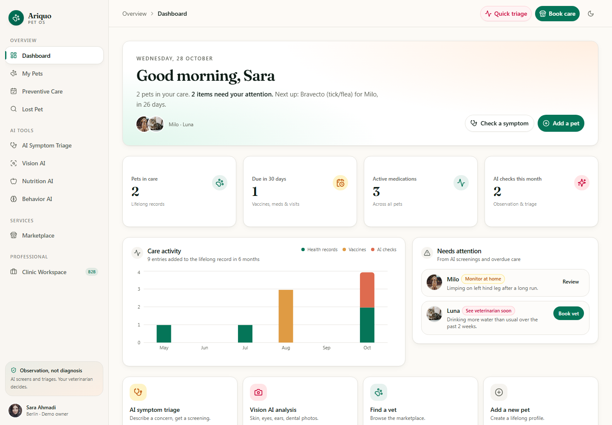
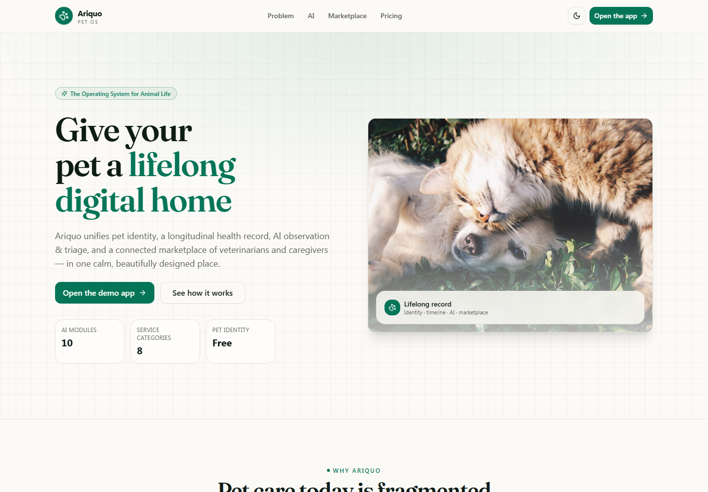
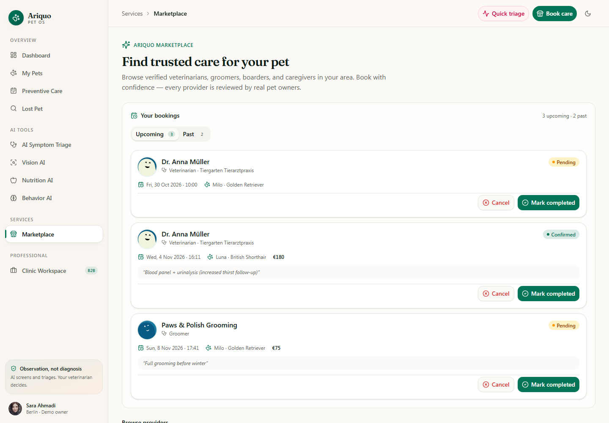
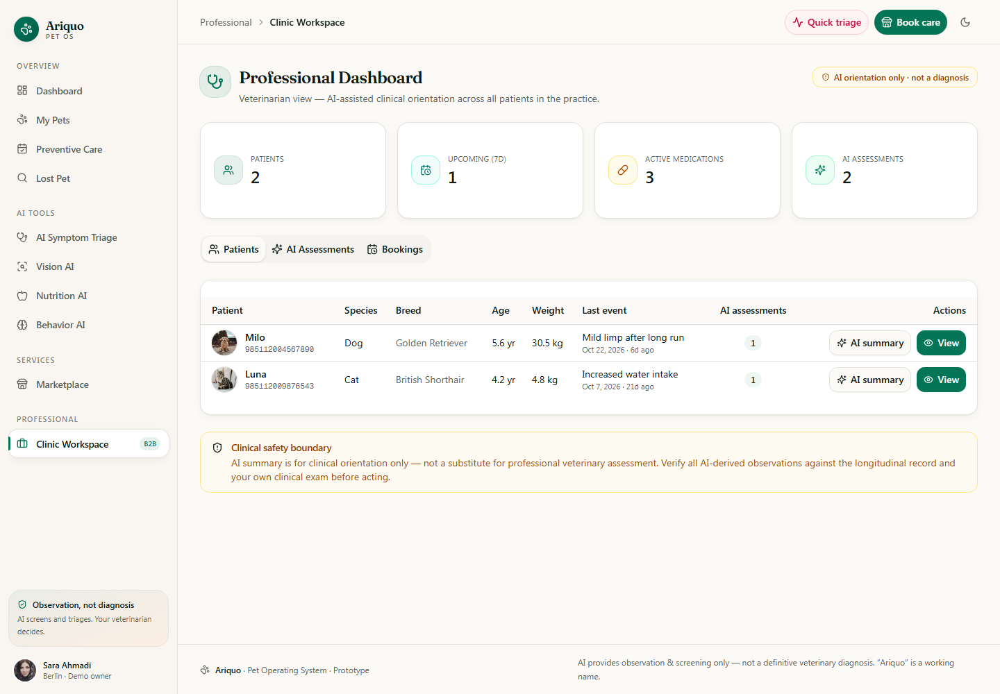

# Ariquo — Pet Operating System (prototype)

Ariquo gives every companion animal a lifelong digital home: one identity, one
longitudinal health record, AI observation & triage, preventive-care reminders,
and a connected marketplace of veterinarians and caregivers, plus a clinic
workspace for professionals built on the same record.

> **Status:** working prototype / investor demo. Single demo owner, no login.
> AI screens provide *observation and triage only*, never a veterinary diagnosis.
> "Ariquo" is a working name.



| Landing | Marketplace | Clinic workspace |
|---|---|---|
|  |  |  |

## What works in the prototype

| Area | What you can do | Backed by |
|---|---|---|
| Owner dashboard | Greeting summary, KPIs, 6-month care-activity chart, "needs attention" (AI flags + overdue care), reminders, appointments | SQLite via Prisma |
| Pet profiles | Create/edit pets, timeline events, vaccines, medications, weight log + trend chart, reminders, AI history | `/api/pets/*` |
| Preventive care & lost pet | Upcoming/overdue care, mark lost/found, recovery playbook, share a lost notice (OS share sheet / clipboard) | `/api/pets/*` |
| AI tools | Symptom triage, vision (skin/dental/eye/ear), nutrition and behavior chat, clinical summary | `/api/ai/*` → configurable LLM provider |
| Marketplace | Browse/filter 8 verified providers and their services, request a booking, cancel or complete it | `/api/providers`, `/api/bookings` |
| Clinic workspace (B2B) | Patient table, AI assessment feed, bookings feed, AI record summary | same record |

Deep links work (`/#/app/dashboard`, `/#/app/pet/<id>`, `/#/app/marketplace`, and so on), as do browser back/forward and refresh.

## Tech stack

Next.js 16 (App Router, Turbopack) · React 19 · TypeScript · Tailwind CSS 4 ·
shadcn/ui (Radix) · TanStack Query · Zustand · Framer Motion · Recharts ·
Prisma 6 + SQLite · Bun (package manager, scripts, tests).

## Getting started

Prerequisites: **Bun ≥ 1.1** (or Node 20+ for `next` itself) and Git.

```bash
bun install
cp .env.example .env      # Windows PowerShell: Copy-Item .env.example .env
bun run setup             # prisma generate + create SQLite DB + seed demo data
bun run dev               # http://localhost:3000
```

Demo data is idempotent (`bun run db:seed` skips if it already exists). To start
over, run `bun run db:reset-demo`. That deletes **only** the demo owner and the
marketplace providers, then reseeds. Seeded dates are relative to *today*, so
reminders and appointments always look current.

### Environment variables

| Variable | Required | Purpose |
|---|---|---|
| `DATABASE_URL` | yes | SQLite file, e.g. `file:./db/custom.db` (relative to `prisma/`) |
| `AI_API_KEY` | no | Any **OpenAI-compatible** Chat Completions key; enables live AI |
| `AI_BASE_URL` | no | Defaults to `https://api.openai.com/v1` |
| `AI_MODEL` / `AI_VISION_MODEL` | no | Default `gpt-4o-mini` |
| `AI_PROVIDER=zai` | no | Use `z-ai-web-dev-sdk` instead (needs a `.z-ai-config` file, which git ignores) |

When no AI provider is configured, the AI screens show a "Live AI is not connected"
notice and `/api/ai/*` return **503 `AI_UNAVAILABLE`**. No placeholder answer is
shown or saved to the record.

## Scripts

| Command | What it does |
|---|---|
| `bun run dev` | Dev server on :3000 |
| `bun run build` | Production build (type-checked) + standalone bundle |
| `bun run start` | Run the standalone server (`.next/standalone/server.js`) |
| `bun run lint` / `bun run typecheck` | ESLint / `tsc --noEmit` |
| `bun run test` | Unit tests; add `TEST_BASE_URL=http://localhost:3000` to also run the read-only API checks against a running server |

## Project layout

```
prisma/schema.prisma        data model (owner, pet, record, AI assessments, marketplace)
src/app/page.tsx            single-page entry + hash router
src/app/api/**              route handlers (owner-scoped, validated)
src/lib/ai.ts               AI provider layer + safety prompt
src/lib/session.ts          demo-owner session + ownership checks
src/lib/seed.ts             relative-date demo seed
src/components/app-shell.tsx  sidebar, top bar, section switcher
src/components/{dashboard,ai,marketplace,professional,landing}/
docs/WORKLOG.md             history of the original build
```

## Known limitations

- **No authentication.** Every request acts as the single seeded demo owner
  (`src/lib/session.ts`). The routes are already owner-scoped, so real auth can
  replace `getCurrentOwner()`.
- **AI needs a provider key.** Without one, the AI features are unavailable (honestly reported).
- **Bookings are requests only.** No payment and no provider notification. The UI says so.
- Lost-pet "share notice" uses the device's share sheet or clipboard. There is no broadcast network.
- Documents tab lists records only. File upload storage is not implemented.
- Provider avatars, pet photos and owner avatar load from Unsplash, pravatar and DiceBear.
- SQLite is for local and demo use only. Use Postgres for multi-user deployment.

## Next steps

1. Real authentication (owner and clinic roles), using the existing owner-scoped routes.
2. Postgres + Prisma migrations, plus a hosted demo (e.g. a container on Coolify/Fly).
3. Document upload storage and vaccine-certificate parsing.
4. Provider-side booking confirmation and notifications.
5. Evaluation set for AI triage safety (escalation recall on emergency cases).
